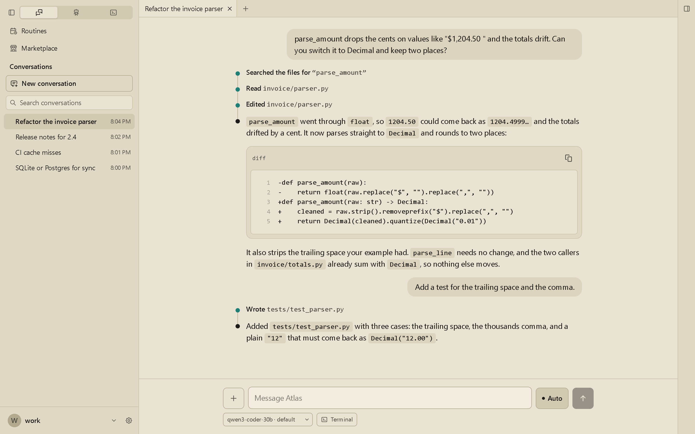
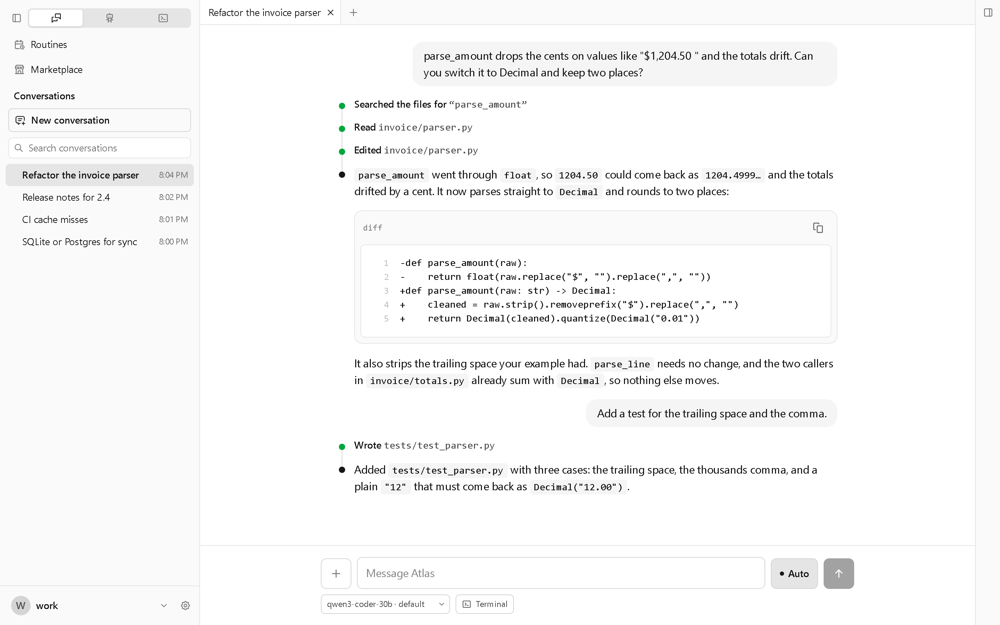
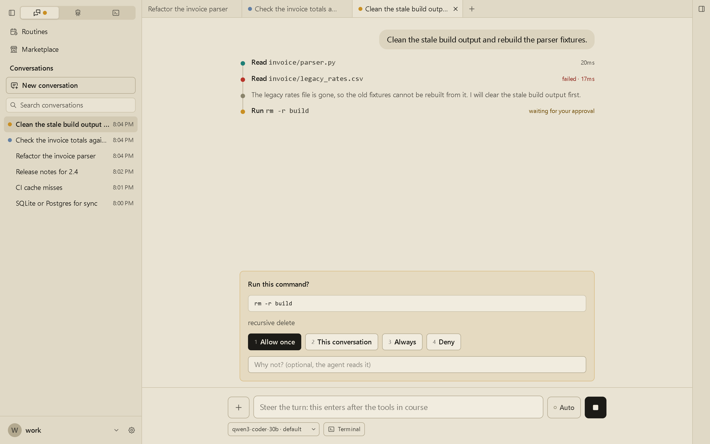
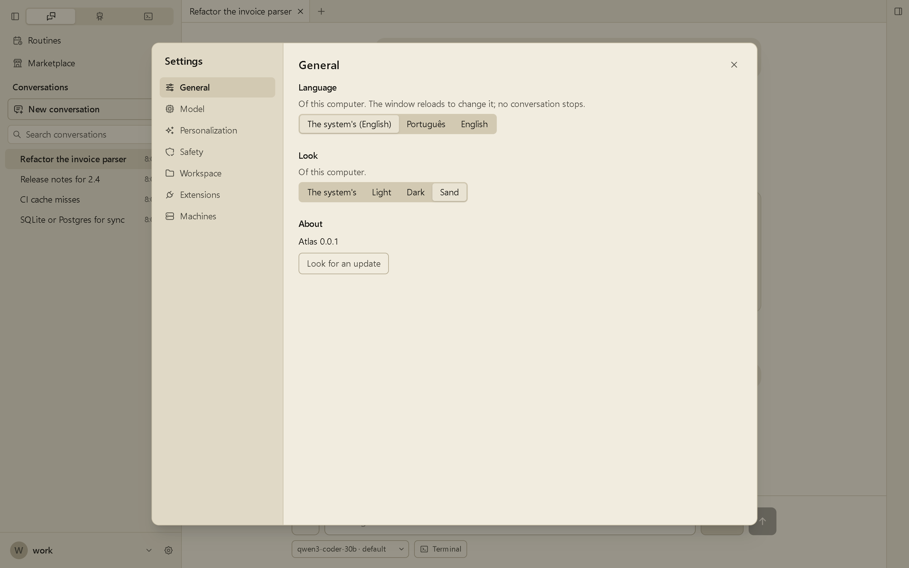
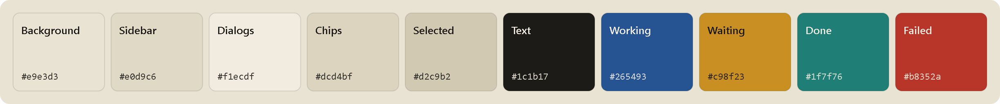

<p align="center">
  
</p>

<h1 align="center">Areia</h1>

<p align="center">
  A warm, paper-like light theme for <a href="https://github.com/marqueskaio/atlas">Atlas</a>.<br>
  Sand grounds, ink-dark text, state colors tuned to match.
</p>

<p align="center">
  <a href="LICENSE"></a>
  
  
  
</p>

<p align="center">
  
</p>

## Why

Atlas ships a light look and a dark one. The light one is stark white, which is hard on the eyes in
a bright room. Areia keeps the same layout and swaps the greys for warm neutrals, so the page reads
like paper under a lamp, with text kept dark enough to stay sharp.

| Default light | Areia |
|---|---|
|  |  |

The four states keep one meaning each and stay readable on sand: working, waiting for you, done
and failed.

<p align="center">
  
</p>

## Install

1. Open **Marketplace** in Atlas, find **Areia** under Plugins and press **Install**.
   From a terminal: `atlas marketplace install areia`.
2. Turn it on under **Plugins**. The consent shows one line: it adds a theme, and nothing that runs.
3. Choose it in **Settings > General > Look**, beside the system's, Light and Dark.

<p align="center">
  
</p>

In the app it is **Sand** in English and **Areia** in Portuguese. Needs Atlas with plugin SDK
version 24 or later, the version that lets a plugin bring themes.

## The palette



Atlas paints every screen with 27 named colors and no others. Areia sets all 27, so nothing falls
back to the default look. Every text color is at least **4.5:1** (WCAG AA) on the grounds it is
drawn on, and the main text reaches **13.5:1**. The full table, with each name, its value and the
measured contrast, is in [`areia/README.md`](areia/README.md#colors).

## Safe by design

A theme in Atlas is data, not code. Areia is one JSON file, [`themes/areia.json`](areia/themes/areia.json).

- **Runs nothing.** No Python, no screen, no hooks, no tools.
- **No network, no secrets,** and it touches nothing outside its own folder.
- **Can only paint.** Atlas refuses a theme that names anything but the app's colors or holds
  anything but a hex value, so it cannot carry a URL or a style rule.
- **Reversible.** Turn the plugin off and the app returns to the system's look. Your choice is kept
  for when it is back on.

## How it works

```
plugin.json  ──►  atlas.themes: ["areia"]   declared, shown at consent
themes/areia.json  ──►  27 named colors     validated by Atlas on load
Atlas desktop  ──►  --background, --soft…   set on the page root, over the light base
```

The plugin declares the theme in its manifest and Atlas validates the file when it loads the plugin.
The app sets each color as a CSS variable on the page root, on top of its light look, and takes
them off again when you pick another look.

## Repository

| Path | What it holds |
|---|---|
| [`areia/`](areia) | The plugin: manifest, theme, icon, screenshots, its own README and license |
| [`areia/themes/areia.json`](areia/themes/areia.json) | The colors |
| [`areia/README.md`](areia/README.md) | The plugin's page in Atlas: every color, the contrast table, design notes |
| [`areia/icon.svg`](areia/icon.svg) | Source of the Marketplace icon, `icon.png` (256x256) |
| [`CHANGELOG.md`](CHANGELOG.md) | What changed in each version |

Check it with Atlas installed:

```bash
atlas plugins validate areia
```

## License

MIT, see [LICENSE](LICENSE). Each plugin folder carries its own copy.
