# Areia

A warm, paper-like light theme for [Atlas](https://github.com/marqueskaio/atlas): sand grounds,
ink-dark text and state colors tuned to sit on that paper. Two dark companions come with it:
**Coffee**, its warm night twin, and **Graphite**, a cool near-black with cyan accents.

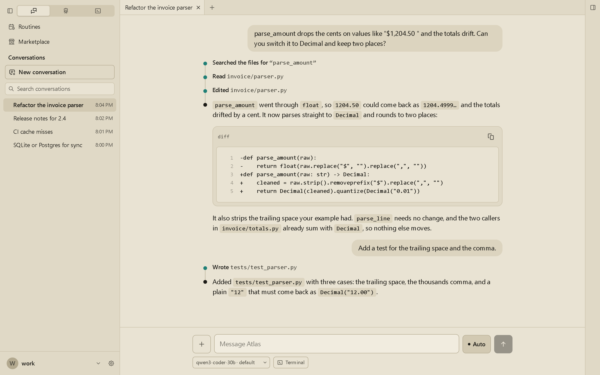

In the app's settings it is called **Sand** in English and **Areia** in Portuguese.

## Before and after

The same conversation in Atlas's default light look and in Areia. The layout does not move; only
the colors change.

| Atlas, light (default) | Atlas, Areia |
|---|---|
| 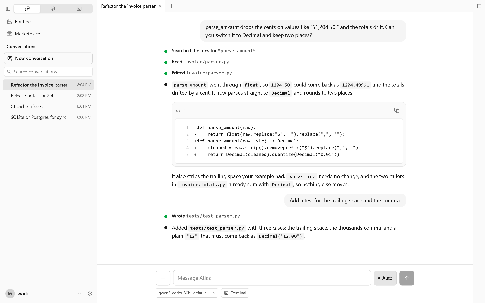 |  |

The four states keep one meaning each and stay readable on sand: working (blue), waiting for you
(amber), done (green) and failed (red).

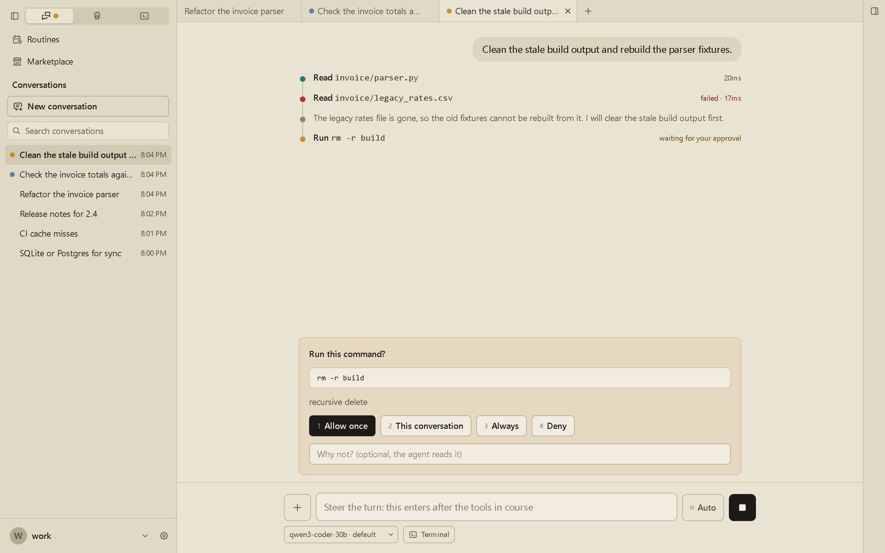

## What it changes, and what it doesn't

**Changes**

- All 27 named colors Atlas paints with: grounds, text, lines, focus ring, actions, states, and
  added and removed lines.

**Doesn't change**

- Layout, fonts, sizes or spacing.
- Native form controls and scrollbars: the theme sits on `light`, so they keep their light variants.
- Your files, settings or other plugins: it only adds a choice to **Look**.

## Install

1. Open **Marketplace** in Atlas, find **Areia** under Plugins and press **Install**.
2. Turn it on under **Plugins**. The consent shows one line: it adds a theme, and nothing that runs.
3. Choose **Sand**, **Coffee** or **Graphite** in **Settings > General > Look**, beside the
   system's, Light and Dark.

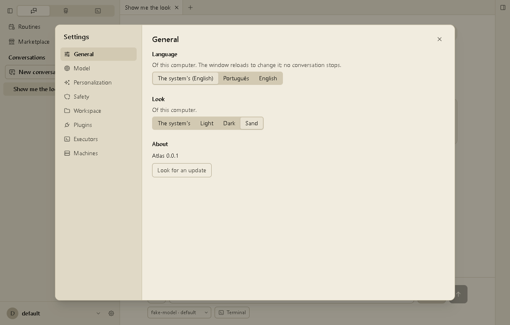

From a terminal, steps 1 and 2 are:

```bash
atlas marketplace install areia
atlas plugins enable areia
```

Needs Atlas with plugin SDK version 24 (`atlas.api` 24) or later, the version that lets a plugin
bring themes.

## Safety

It brings three files, [`themes/areia.json`](themes/areia.json),
[`themes/cafe.json`](themes/cafe.json) and [`themes/grafite.json`](themes/grafite.json): each a hex
color for every one of the app's named colors, on top of the app's light or dark look. Nothing else.

- **It runs no code.** No Python, no screen, no hooks, no tools, no scripts.
- **It reaches no network** and reads no secret.
- **It touches nothing outside its own folder.**
- **It cannot paint anything but the app's named colors.** Atlas refuses a theme that names any
  other variable or holds anything that is not a hex color, so a theme is data and cannot carry a
  URL or a style rule.

If you turn the plugin off, the app goes back to the system's look and keeps your choice for when
the plugin is on again.

## Palette

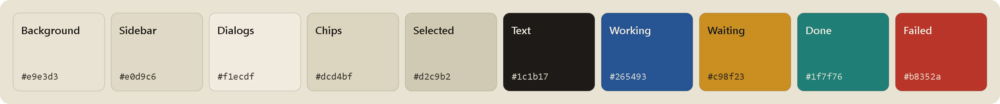

Atlas paints every screen with 27 named colors and no others; this theme sets each of them, so
nothing falls back to the default light look.

**Grounds**

| Name | Color |
|---|---|
| `background` | `#e9e3d3` |
| `subtle` | `#e0d9c6` |
| `raised` | `#f1ecdf` |
| `muted` | `#dcd4bf` |
| `hover` | `#d9d1bb` |
| `selected` | `#d2c9b2` |
| `scrim` | `#1c1b1766` |

**Text**

| Name | Color |
|---|---|
| `foreground` | `#1c1b17` |
| `soft` | `#4b4940` |
| `muted-foreground` | `#55524a` |
| `faint` | `#8a846c` |

**Lines and focus**

| Name | Color |
|---|---|
| `border` | `#cbc2aa` |
| `border-strong` | `#b3a98f` |
| `ring` | `#6d6a5c` |

**Actions**

| Name | Color |
|---|---|
| `primary` | `#1c1b17` |
| `primary-foreground` | `#f1ecdf` |

**States**

| Name | Color |
|---|---|
| `working` | `#265493` |
| `waiting` | `#c98f23` |
| `waiting-text` | `#6e4a00` |
| `waiting-foreground` | `#3a2808` |
| `done` | `#1f7f76` |
| `done-text` | `#115a54` |
| `failed` | `#b8352a` |
| `failed-text` | `#8f261c` |
| `danger` | `#b8352a` |
| `added` | `#1f7f76` |
| `removed` | `#b8352a` |

### Contrast

Every text color is at least 4.5:1 (WCAG AA) on the four grounds a screen draws text on. The ratios
below were computed from the hex values with the WCAG relative-luminance formula; `foreground` on
`background` reaches 13.5:1.

| Text color | on `background` | on `subtle` | on `raised` | on `muted` |
|---|---|---|---|---|
| `foreground` `#1c1b17` | 13.5 | 12.2 | 14.6 | 11.7 |
| `soft` `#4b4940` | 7.0 | 6.4 | 7.7 | 6.1 |
| `muted-foreground` `#55524a` | 6.1 | 5.5 | 6.6 | 5.3 |
| `working` `#265493` | 5.9 | 5.4 | 6.4 | 5.1 |
| `waiting-text` `#6e4a00` | 6.2 | 5.6 | 6.7 | 5.4 |
| `done-text` `#115a54` | 6.3 | 5.7 | 6.8 | 5.4 |
| `failed-text` `#8f261c` | 6.7 | 6.1 | 7.2 | 5.8 |

`faint` only decorates (a chevron, a dot at rest, a word that cannot be used, as Atlas defines it)
and is 2.9:1 on `background` on purpose. `ring`, the keyboard's place, is 4.2:1. `border` and
`border-strong` are edges, not text, at 1.4:1 and 1.8:1: quiet lines on paper.

## Dark companions

The plugin also brings two dark themes, each setting all 27 named colors on top of `dark`, so
native controls and scrollbars take their dark variants. They show as **Coffee** and **Graphite**
in English, **Café** and **Grafite** in Portuguese.

- **Coffee** ([`themes/cafe.json`](themes/cafe.json)): Areia's night twin. Espresso grounds
  (`#1a1714`), cream text (`#ece4d4`), the same warm hue family, so switching from Areia at dusk
  keeps the feel.
- **Graphite** ([`themes/grafite.json`](themes/grafite.json)): a cool near-black (`#0c0e12`) with
  electric cyan (`#5ec8f2`) for working and the focus ring, mint for done and coral red for failed.

| Atlas, dark (default) | Coffee | Graphite |
|---|---|---|
| 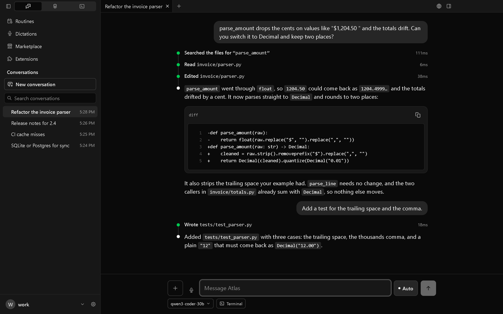 | 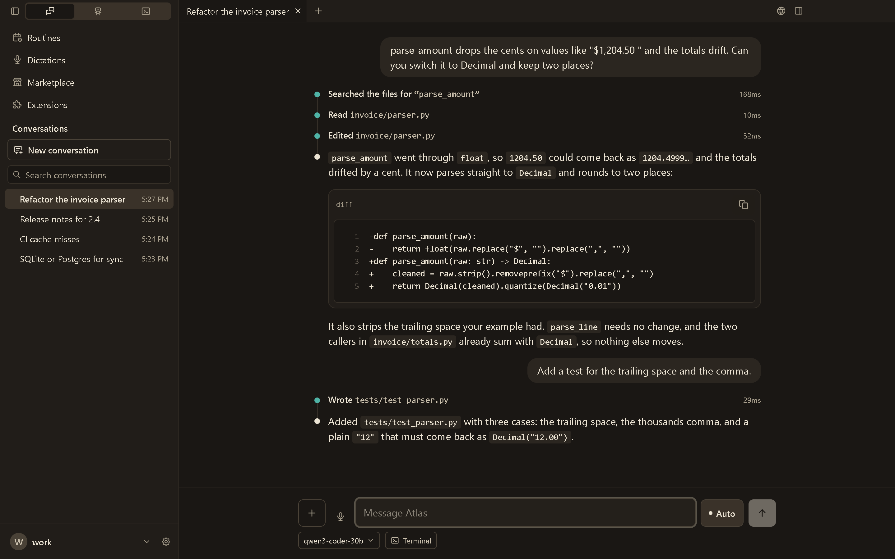 | 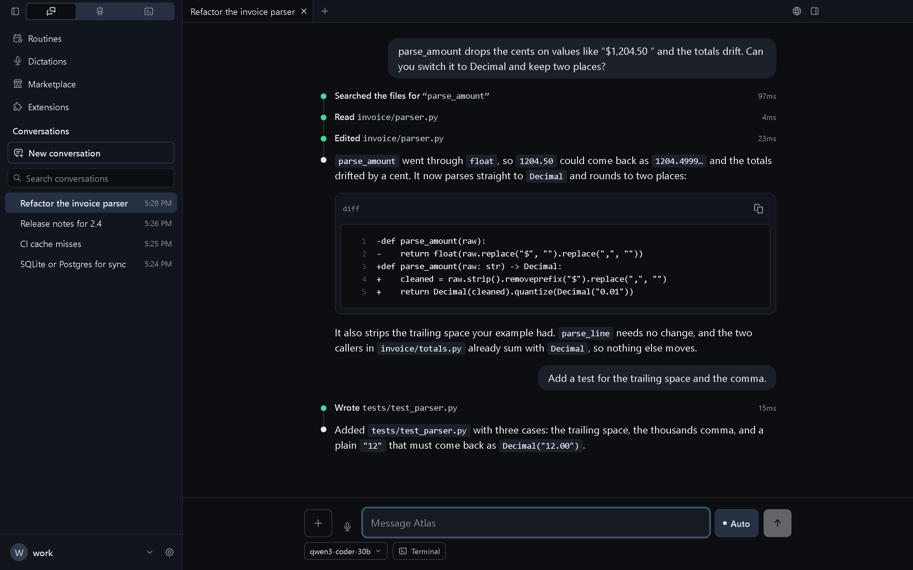 |

The same four states, on espresso and on graphite:

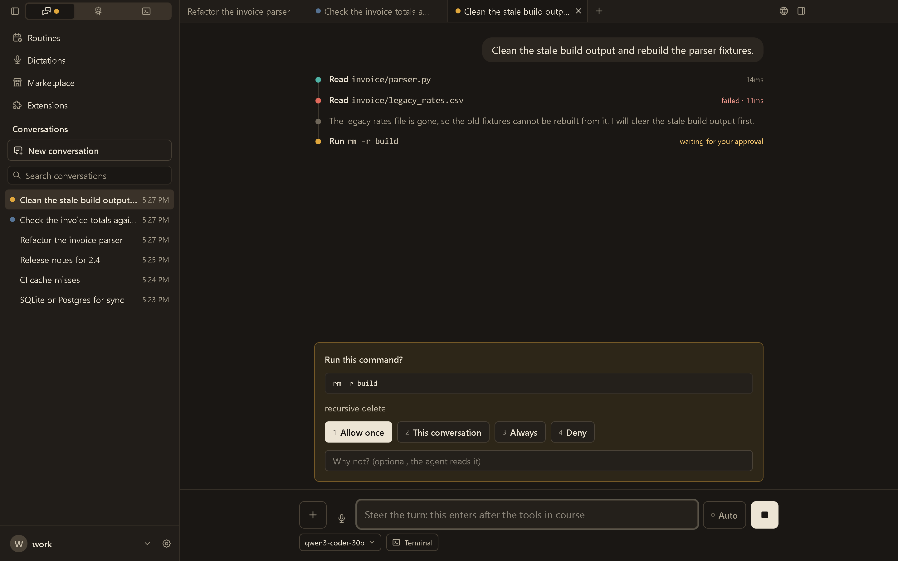

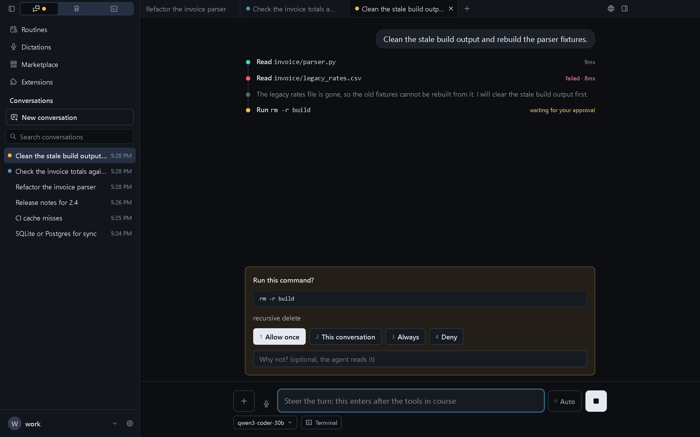

Both are picked in **Settings > General > Look**, beside Sand:

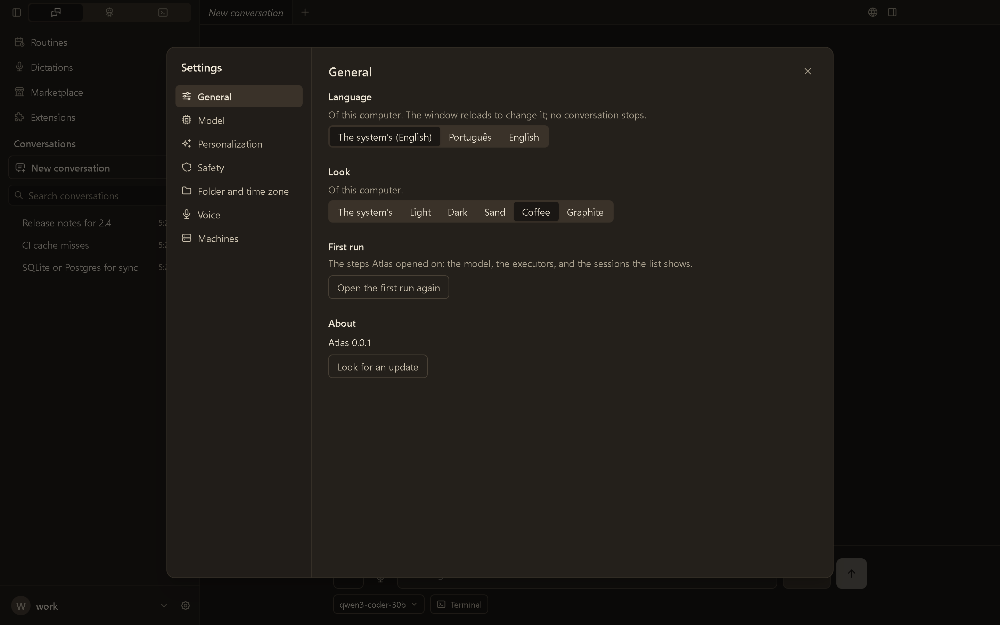

Every text color is at least 4.5:1 on the four text grounds (lowest ratio shown):

| Text color | Coffee | Graphite |
|---|---|---|
| `foreground` | 11.9 | 13.4 |
| `soft` | 8.2 | 8.7 |
| `muted-foreground` | 5.7 | 5.3 |
| `working` | 6.5 | 8.6 |
| `waiting-text` | 9.1 | 11.0 |
| `done-text` | 8.4 | 11.0 |
| `failed-text` | 7.0 | 8.0 |

## Design

- **Warm neutrals.** Every neutral leans yellow-brown (OKLCH hue between 89 and 97 degrees, chroma
  0.01 to 0.03) instead of gray: `background` is `#e9e3d3`, the sidebar a step darker, and dialogs
  and fields a step lighter (`raised`), so depth reads as paper laid over paper.
- **Ink, not black.** Text is `#1c1b17`, a very dark warm brown, which sits softer on sand than
  pure black.
- **States stay legible.** Blue, amber, green and red are the app's four states with one meaning
  each. Their `-text` variants are darkened until they read as words on sand.

## Develop

```bash
atlas plugins validate areia     # loads it as Atlas does and says what is wrong
```

The folder name must equal the plugin's `name`, as Atlas requires. To try a change, copy the folder
into your home's `plugins/`, run `atlas plugins enable areia`, and pick the theme in Settings.

## Changelog

See [CHANGELOG.md](https://github.com/JoaoEquer/atlas-areia/blob/main/CHANGELOG.md).

## License

MIT, see [LICENSE](LICENSE).
